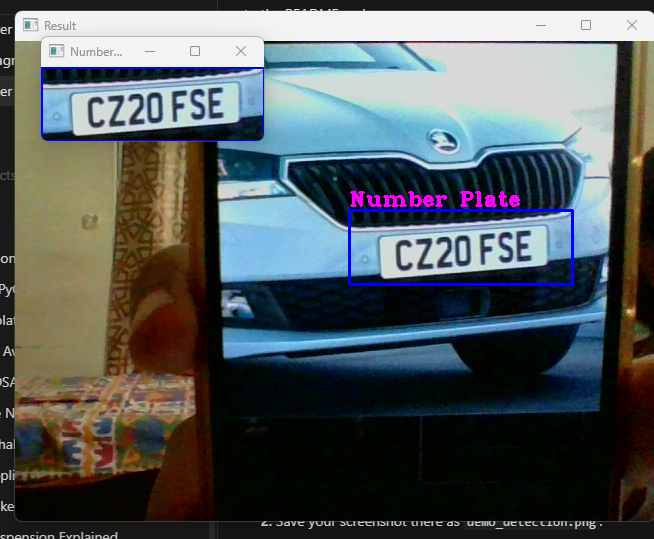

# Vehicle Number Plate Detection

A real-time vehicle number plate detection system built with Python and OpenCV. The program captures a live webcam feed, applies a Haar cascade classifier to locate number plates in each frame, draws a bounding box around detected plates, and displays the cropped plate region in a separate window.

---

## Demo

The screenshots below show the program detecting a number plate (`CZ20 FSE`) in real time, with the cropped ROI displayed in a separate window.



---

## How It Works

```
Webcam frame captured
        │
        ▼
Convert BGR → Grayscale
        │
        ▼
Haar Cascade detectMultiScale()
(haarcascade_russian_plate_number.xml)
        │
        ▼
Filter detections by minimum area (500 px²)
        │
        ▼
Draw bounding box + "Number Plate" label on frame
        │
        ▼
Display full frame in "Result" window
Display cropped plate ROI in "Number Plate" window
        │
        ▼
Press 'q' to quit → release camera → close windows
```

The Haar cascade classifier (`haarcascade_russian_plate_number.xml`) was originally trained on Russian/European-style number plates. Detection accuracy may vary depending on plate style, lighting, distance, and angle.

---

## Technologies

| Technology | Version | Purpose |
|---|---|---|
| Python | 3.12.7 | Runtime |
| OpenCV (`opencv-python`) | 4.10.0.84 | Webcam capture, image processing, Haar cascade detection |
| NumPy | 1.26.4 | Array operations (required by OpenCV) |

---

## Project Structure

```
vehicle-number-plate-detection/
├── assets/
│   └── demo_detection.png                 # Demo screenshot
├── detect_plate.py                          # Main detection script
├── requirements.txt                         # Verified dependencies
├── .gitignore                               # Git exclusions
├── README.md                                # This file
└── models/
    └── haarcascade_russian_plate_number.xml # Pre-trained Haar cascade model
```

---

## Requirements

- Python 3.10 or higher (tested on 3.12.7)
- A working webcam
- Windows / Linux / macOS

---

## Installation

### 1. Clone the repository

```bash
git clone https://github.com/YOUR_USERNAME/vehicle-number-plate-detection.git
cd vehicle-number-plate-detection
```

### 2. Create and activate a virtual environment

**Windows:**
```powershell
py -m venv venv
venv\Scripts\activate
```

**Linux / macOS:**
```bash
python3 -m venv venv
source venv/bin/activate
```

### 3. Install dependencies

```bash
pip install -r requirements.txt
```

---

## Usage

```bash
python detect_plate.py
```

- The `Result` window shows the live webcam feed with a **blue rectangle** and `"Number Plate"` label drawn around any detected plate.
- The `Number Plate` window shows the **cropped region** of the detected plate.
- Press **`q`** to quit.

> **Tip:** For best results, hold the number plate squarely in front of the camera at a distance of 30–60 cm in good lighting.

---

## Limitations

- **Webcam only** — the script does not currently support video file or image file input.
- **No OCR** — the script detects and crops the plate region but does not read the text on the plate.
- **False positives** — the cascade occasionally flags non-plate rectangular regions (grilles, vents, signs, windows) as number plates, particularly against complex or high-contrast backgrounds.
- **Inconsistent detection** — detection is not guaranteed on every frame. Plates may appear and disappear between frames depending on distance, angle, and lighting conditions.
- **Cascade accuracy** — the Haar cascade was trained on Russian/European plate styles. Detection rates on Indian or other regional plate formats will vary.
- **Lighting sensitivity** — Haar cascades are sensitive to poor lighting, extreme angles, and motion blur.
- **No tracking** — each frame is processed independently; there is no cross-frame plate tracking.
- **Single camera** — hard-coded to webcam index `0`. Change `cv2.VideoCapture(0)` to use a different camera.

---

## Internship Context

This project was developed during an internship as a practical application of computer vision concepts including:

- OpenCV webcam capture pipeline
- Colour space conversion (BGR → Grayscale)
- Haar cascade object detection
- Region of interest (ROI) cropping and display

---

## License

This project was developed for educational and internship purposes. No open-source license has been formally assigned to the project code at this time.

The Haar cascade file (`haarcascade_russian_plate_number.xml`) is a third-party model file. It is part of the OpenCV project and is subject to the [OpenCV BSD license](https://opencv.org/license/).
